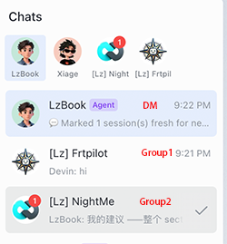
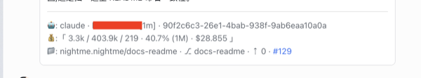

# NightMe

<p align="center">
  
</p>

> **Sleep tight. NightMe codes all night.**
>
> A remote-pair developer agent. No more babysitting AI—stay in the loop from your phone while it takes the wheel.

[English](./README.md) · [简体中文](./README.zh-CN.md)


## What is NightMe

**NightMe** drives your local AI Coding Agents — Claude Code, Codex, DSH (DeepSeek Harness), GitHub Copilot CLI, Pi, OpenCode, etc. — from chat. Send a message in any connected chat platform; NightMe routes it to the right agent process and returns the reply as a structured card.

Multiple chats run in parallel — one per project. Multiple agents work in parallel, each on its own task — switching between them is instant, no cold restart. The whole development cycle is standardized as the [Git Team Workflow](#git-team-workflow-gtw) (`/gtw`): discussion → issue → worktree → commit → push → PR → close, each step one slash command and one IM card, integrated with GitHub and GitLab. NightMe doesn't replace your agent subscriptions or memory; it sits in front of them and keeps them warm.

## Why NightMe

### One chat, one CWD, one project

You work across multiple projects at once. Each chat in a connected chat channel — group or DM — is a **ChatSession**, and each ChatSession has a **CWD** — its current working directory. The CWD *is* the project: set it with `/cwd <path>`, change it anytime. Multiple chats run in parallel, each bound to its own directory. See [Chat Channels](#chat-channels) for the channels available today.

```
                       You (any chat channel)
                                  │
                                  ▼

    ┌─ ChatSession ─┐  ┌─ ChatSession ─┐  ┌─ ChatSession ─┐
    │ CWD: ~/a      │  │ CWD: ~/b      │  │ CWD: ~/c      │
    │               │  │               │  │               │
    │ AI Agents:    │  │ AI Agents:    │  │ AI Agents:    │
    │   Claude Code │  │   Claude Code │  │   Claude Code │
    │   Codex       │  │   Codex       │  │   Codex       │
    │   Pi          │  │   Pi          │  │   Pi          │
    │   OpenCode    │  │   OpenCode    │  │   OpenCode    │
    │   DSH         │  │   DSH         │  │   DSH         │
    │   Copilot     │  │   Copilot     │  │   Copilot     │
    └───────────────┘  └───────────────┘  └───────────────┘

   ▲ CWD = project; agents run inside that CWD; all parallel from one NightMe instance ▲
```



**Project isolation is by directory.** Each ChatSession's CWD is independent — re-running `/cwd` changes which directory a session operates on, without affecting the others. Multiple projects stay
live simultaneously.

**The differentiator vs traditional tools** (Hermes, openclaw, cc-connect, happycoder): they activate one session at a time. NightMe runs all your projects in parallel from a single instance. Switching chats is instant — same daemon, no cold start, no re-init.

### Three core capabilities

| Capability | What it means in practice |
|---|---|
| **Multiple Chat Sessions in parallel** | N sessions on one machine, each running a different project or task. |
| **CWD = project** | Each ChatSession is bound to one current working directory — that directory *is* the project. Set it with `/cwd <path>`; switch anytime. |
| **Multi-agent, in the same Chat** | `/use <agent>` swaps the active agent. The previous one keeps running in the background — its task continues, results still come back, but new messages route to the new active agent. |

> **Built on top: the [Git Team Workflow](#git-team-workflow-gtw).** Settle a design with `/gtw plan` → `/gtw new` turns the discussion into an issue → `/gtw fix <id>` opens a worktree and hands the issue to the agent → `/gtw commit` · `/gtw push` · `/gtw pr` ship it with Conventional Commits → `/gtw close` cleans up. One standard for requirements, development, and Git operations across the whole team.

## Supported integrations

NightMe works with the AI coding agents you already use and the chat
apps you already live in. Here's what's available today — and what's on
the way.

### AI Coding Agents

| Agent | Status |
|---|---|
| **Claude Code** | Available |
| **Codex** | Available |
| **Pi** | Available |
| **DSH** (DeepSeek Harness) | Available — requires **`dsh@0.2.0-rc.2`**, `dsh@0.1.2-rc.1` … `dsh@0.2.0-rc.2` all verified wire-compatible (see [docs/bridge/dsh.md §0.1](./docs/bridge/dsh.md#0-dsh-版本约束)) |
| **Cursor** | Available |
| **OpenCode** | Available |
| **GitHub Copilot CLI** | Available |

### Chat Channels

| Channel | Status |
|---|---|
| **Feishu** (China) / **Lark** (International) | ⭐ Recommended — `nightme login feishu` |
| **Telegram** | Ready — `nightme login telegram` |
| **Slack** | In development — `nightme login slack` |

## Prerequisites

- **macOS, Linux, or Windows** — NightMe ships as a single Go binary. The
  default Linux build is fully static with no runtime dependencies; see
  [Linux: tray-less by default](#linux-tray-less-by-default) if you want the
  system-tray icon.
- **A chat channel** — see [Chat Channels](#chat-channels) for what's supported today. `nightme login feishu` registers via QR scan; `nightme login telegram` walks through the BotFather token setup.
- **At least one local AI Coding Agent** — Claude Code, Pi, OpenCode, Codex, DSH (DeepSeek Harness), or GitHub Copilot CLI. Install the CLI and have it on your `$PATH`; NightMe spawns it as a subprocess. **DSH** — install with `npm i -g @deepseek-ai/dsh@0.2.0-rc.2` and verify with `dsh --version`. Versions `0.1.2-rc.1` … `0.2.0-rc.2` are wire-compatible; see [docs/bridge/dsh.md §0.1](./docs/bridge/dsh.md#0-dsh-版本约束).

  If none is on `$PATH`, NightMe's first run detects the gap and prompts you to enter the absolute path to whichever binary you have installed (e.g. `/Users/me/.local/bin/claude`). The path is saved in `~/.nightme/config.yaml` and applied on every subsequent run — no shell re-login required. In a non-interactive session (CI, supervisor, container) NightMe exits non-zero instead of prompting; configure the path before launching, or run `nightme config` interactively.

## Install

Three ways to get `nightme` on your machine:

1. **One-liner** (recommended):

   **macOS / Linux:**
   ```bash
   curl -fsSL https://nightme.dev/install.sh | bash
   ```

   **Windows (PowerShell):**
   ```powershell
   powershell -c "irm https://nightme.dev/install.ps1 | iex"
   ```

   Drops the latest release into a stable location on your `$PATH`
   and runs `nightme version` to verify. On Linux this installs the
   tray-less build — see [below](#linux-tray-less-by-default).

2. **Prebuilt binary** (manual):

   - Grab the archive for your platform from the
     [latest release page](https://github.com/cnlangzi/nightme/releases/latest)
     (e.g. `nightme_<version>_darwin_amd64.tar.gz`,
     `nightme_<version>_linux_amd64.tar.gz`,
     `nightme_<version>_windows_amd64.zip`)
   - Extract it — the binary inside is just `nightme`
     (or `nightme.exe` on Windows):
     ```bash
     tar -xzf nightme_<version>_darwin_amd64.tar.gz
     mv nightme /usr/local/bin/nightme
     chmod +x /usr/local/bin/nightme
     ```
     On Windows, unzip and place `nightme.exe` somewhere on your `PATH`.
   - Linux also publishes a `-gui` archive per architecture — see
     [below](#linux-tray-less-by-default).

3. **From source** (for development or to pin a commit):

   ```bash
   git clone https://github.com/cnlangzi/nightme.git
   cd nightme
   make dev
   ```

   `make dev` runs nightme directly from source using the example
   config in `./configs/`. For a proper release-style build (with
   the Windows icon embedded, macOS menu-bar template icons, and
   version metadata baked in), use `make build` or `make release`.

4. **macOS .app bundle** (optional, for the menu-bar experience):

   A bare `nightme` binary on macOS still works, but the menu-bar
   icon falls back to the generic executable glyph. To get the
   proper icon, build the .app bundle:

   ```bash
   make build              # bin/nightme + cmd/nightme/assets/trayTemplate.icns
   make app-bundle         # dist/NightMe.app
   cp -R dist/NightMe.app /Applications/
   open /Applications/NightMe.app
   ```

   The .app has `LSUIElement=true`, so it shows no Dock entry —
   just the menu-bar icon. Closing the app from the menu (Stop /
   Quit) gracefully exits the daemon.

   config — no separate build step needed.

### Linux: tray-less by default

Linux publishes **two archives per architecture**:

| Archive | Tray icon | Runtime dependencies |
| --- | --- | --- |
| `nightme_<version>_linux_<arch>.tar.gz` | no | none — fully static |
| `nightme_<version>_linux_<arch>-gui.tar.gz` | yes | `libgtk-3-0`, `libayatana-appindicator3-1` |

The default archive is the one `install.sh` fetches, and it is what you want on
a server. It is a fully static binary that links nothing, so it runs on any
Linux host regardless of distro, glibc version, or installed packages.

The system-tray icon needs GTK3 and AppIndicator, which are libraries a
headless server has no reason to carry. Shipping them as a hard requirement
meant the binary could not start *at all* on a bare server — not even
`nightme version` — because the dynamic loader refuses the process before any
code runs:

```
nightme: error while loading shared libraries: libayatana-appindicator3.so.1:
cannot open shared object file: No such file or directory
```

So the tray is opt-in on Linux. If you run NightMe on a desktop and want the
icon, install the `-gui` archive over your existing one — the binary inside is
also named `nightme`, so nothing else changes:

```bash
sudo apt install libgtk-3-0 libayatana-appindicator3-1   # Debian / Ubuntu
tar -xzf nightme_<version>_linux_amd64-gui.tar.gz
sudo mv nightme /usr/local/bin/nightme
```

Building from source follows the same split — `make build` gives you the
tray-less binary, `make build-gui` gives you `bin/nightme-gui` (needs
`libgtk-3-dev` and `libayatana-appindicator3-dev`).

Nothing is lost by running tray-less: the daemon is controlled over its Unix
socket, so `start` / `stop` / `restart` / `status` / `logs` and the REPL all
behave identically. macOS and Windows are unaffected — their tray backings ship
with the OS, so the tray is always built in.

---

## Upgrade & maintenance

`nightme update` is the in-place upgrade path: it resolves the latest release, downloads the matching asset, verifies it against the published SHA256SUMS, swaps the binary, and restarts the daemon. Pin a release with `--tag vX.Y.Z`; skip prompts with `--yes` (CI); pre-warm the download without installing with `--no-install`. Re-running the one-liner install script performs the same swap.

`nightme clean` zeroes `nightme.log` and `daemon-stderr.log` and clears the per-session attachment inbox (`~/.nightme/inbox`), preserving config, session state, lock files, and the daemon socket. `nightme clean --all` is a full local reset — it also removes config, session stores, lifecycle files, and caches; stop the daemon before using `--all`.

## Quickstart

```bash
nightme login feishu   # prints a QR code; scan with the Feishu mobile app
nightme start          # daemon runs in the background
```

When `start` returns, NightMe sends a welcome message to your Feishu DM — that's how you know you're live.

### CLI commands

Most of the time you live in chat. These are the few things you do from a terminal:

| Command | What it does |
|---|---|
| `nightme start` / `stop` / `restart` | Turn NightMe on and off. Your agents keep working either way. |
| `nightme status` | Is NightMe running? |
| `nightme list` | All your agents: which chat, which project, still alive or finished. |
| `nightme kill` | Stop every agent at once. Send a message in the chat and it comes back, conversation intact. |
| `nightme logs` | Watch what NightMe is doing, live. |
| `nightme config` | Interactive menu: instance name, primary agent, per-agent binary path. |
| `nightme update` | In-place upgrade: check, download, SHA256-verify, install, restart the daemon. |
| `nightme clean` | Truncate logs and clear the attachment inbox; `--all` for a full local reset (stop the daemon first). |
| `nightme workflow` | List / show / dry-run the workflow YAMLs under `~/.nightme/workflows/`. |
| `nightme doctor` | Check NightMe's health when something feels off. Unix only. |
| `nightme version` | Print version info. |

`nightme test` spawns a CLI in a PTY for a quick local check.

Stopping comes in three scopes: `/close` (one project) · `nightme kill` (all agents) · `nightme stop` (NightMe itself). Your conversations survive all three.

---

## Always-in-the-loop

You always know what your agent is doing, where, and at what cost — every reply carries a fixed footer with what you need to know, without leaving chat. Most other "AI dev in chat" tools feel like a black box; NightMe treats visibility as a first-class feature.

### StatusBar — pinned to every Feishu reply



Every reply carries a fixed footer showing exactly what you need to know without leaving chat:

- **CWD** — which ChatSession is active (the "project")
- **Git status** — branch, dirty / clean, ahead / behind
- **Agent status** — `idle` / `running` / `thinking`
- **Token usage** — used / limit for the current session

Other tools drop you into the dark. NightMe shows you what your agent is doing, where, and at what cost.

### Flexible visibility — you decide what to see

| Toggle | What it controls |
|---|---|
| `/think on\|off` | Show or hide the agent's thinking blocks. |
| `/tools on\|off` | Show or hide per-tool thread replies (default off). |
| `/watch on\|off` | Listen to all group messages, not just `@bot` / `@_all`. |

**Why this matters:** NightMe defaults to visible. Toggle things off when you want quiet — your choice, no surprises.

---

## What we do differently


| Feature | Openclaw / Hermes | NightMe |
|---|---|---|
| Sessions survive daemon restart | ❌ | ✅ |
| Real `/stop` and `/steer` | ❌ | ✅ |
| No server-side timeout | 30 min | none |
| Clean prompts, no preamble | ❌ | ✅ |

The four differentiators, in short:

1. **Sessions survive.** Daemon restart, network blip, sleep — your chat picks up where it left off. The upstream CLI's session resumes via `--resume <session-id>`.

2. **You can stop or redirect, mid-task.** `/stop` halts the in-flight turn. `/steer <msg>` redirects. Both keep your session and context intact.

3. **No clock on you.** If Claude runs 30 minutes, NightMe runs 30 minutes. You're in charge of when to stop.

4. **No prompt padding.** No preamble, no brand voice, no injected system message. The CLI sees just your words.

We sit in front of Claude / Codex / DSH (DeepSeek Harness) / Pi / OpenCode. You stay in control. Nothing in a black box.

---

## Shell mode

You don't always need the agent to run a shell command. With Claude Code / Codex, asking the agent to run something goes through the agent's tool loop — long chain, eats context, nudges your real task aside while the agent's busy reading shell output.

`!cmd` skips all that. Type `!make test` and NightMe runs the command in the chat's CWD directly. The result comes back as a plain IM card. No agent, no round trip, no context eaten.

For the scripts you already have — `make`, `npm test`, deploy hooks. Anywhere the agent's reasoning adds nothing but a delay.

```
✅ $ make test
exit 0 · 12ms · ~/work/foo
stdout:
  All tests passed
```

## Git Team Workflow (`/gtw`)

**`/gtw` is a complete Git team workflow — from a chat discussion to a merged PR — driven entirely from chat.** Every requirement becomes an issue, every issue gets its own branch and worktree, every commit and PR follows Conventional Commits, and the issue's state on GitHub / GitLab tracks the work. The same conventions apply no matter which teammate, or which AI agent, does the work: requirements, development, and Git operations all follow one standard.

```
 /gtw plan ──▶ /gtw new ──▶ /gtw new -y ──▶ /gtw fix <id> [-y] ──▶ /gtw commit ──▶ /gtw push ──▶ /gtw pr ──▶ /gtw close
 (design)      draft         issue #N        worktree + agent        commit          remote        PR          done
                                                   ▲   │
                                                   └───┘ /handoff <name> · /resume <name>
                                                         (context too long, or switching agents)
```

| Step | Command | What it standardizes |
|---|---|---|
| 1. Requirement | `/gtw plan` → `/gtw new` → `/gtw new -y` | The design is settled in chat before any code changes, then becomes a self-contained issue: background, scope, requirements with acceptance criteria, design, decisions, implementation plan. |
| 2. Implement | `/gtw fix <id> [-y]` | One issue = one branch = one worktree, cut from the freshly synced default branch. The issue gets the `nightme/wip` label and is dispatched to the agent. |
| 3. Hand off *(optional)* | `/handoff <name>` · `/resume <name>` | Task state is written to a file, so a fresh session or a different agent continues without losing progress. |
| 4. Commit | `/gtw commit [-a <agent>]` | An agent stages the changes and writes Conventional Commits messages. Local only. |
| 5. Push | `/gtw push` | Pushes the branch to `origin`. Refuses a dirty worktree. |
| 6. PR | `/gtw pr [-a <agent>]` | Opens a PR / MR with a Conventional Commits title, a structured body, and `Closes #<id>`. |
| 7. Close | `/gtw close` | Removes the `nightme/wip` label, the worktree, and the local branch; returns the chat to the default branch, synced. |

Steps 1–2 run in the chat's current agent session, so you keep talking to the agent that did the analysis. `commit` and `pr` run a one-shot agent that exits when done, keeping the main conversation clean. `push`, `close`, `back`, and `sync` are pure Git / platform operations with no agent involved. Each step replies with one IM card. GitHub (`gh`) and GitLab (`glab`) are detected from `origin`; first use on a new repo needs no setup.

Parallel work is the default: three issues means three worktrees, three branches, and three agents, with no shared state between them.

### 1. Requirement → issue: `/gtw plan` · `/gtw new`

**`/gtw plan [topic]`** puts the chat's current agent into plan mode before a requirement is discussed. The agent works as a design partner: it reads only the code a decision depends on, compares options and recommends one, asks only what the repository cannot answer, and marks every settled point with a `Decision:` line. It does not edit files, run builds or tests, write implementation code, or break the design into tasks, and it reads imperative requirements ("change X in file Y") as design input to check, not as instructions to carry out. Also, agreeing with a proposal does not make it start implementing — when the design is complete it tells you to run `/gtw new`. Plan mode ends when `/gtw new` drafts the issues; running `/gtw plan` again restates the rules without restarting the discussion.

After a back-and-forth with the agent about a requirement, **`/gtw new`** archives that discussion into GitHub / GitLab issues that a developer or coding agent can implement without having seen the chat. It runs in the chat's **current** agent session, because the discussion only exists there.

It is a two-step command — the agent drafts, you decide:

1. **`/gtw new`** — the agent extracts every requirement, constraint, decision, and edge case from the conversation, using the `Decision:` lines of plan mode as settled points, and resolves contradictions (rejected options move to a *Decisions* section with their reasons). If something blocking is still undecided, it asks once — all questions in one message, each with a recommended default — and stops; answer in chat and it goes on to write the drafts (running `/gtw new` again works too). A discussion becomes one issue by default — code, tests, and docs of a change always stay together. Only when the discussion holds unrelated goals, each of which counts as done without the others, does it propose splitting them into several issues in that same round of questions; once you agree, each issue gets its own draft. Otherwise it writes the draft and shows the full document in chat: background and goal, scope, glossary, requirements with acceptance criteria, design, edge cases, constraints, decisions, implementation plan, open questions. Ask for changes in chat — including splitting or merging issues — and it rewrites the drafts.
2. **`/gtw new -y`** — once the drafts look right, NightMe creates one issue per draft, in draft order, through `gh` / `glab`, ending each body with a *Generated by NightMe* line, and replies with the numbers. Drafts reference each other as `{{ISSUE:NN}}`, replaced by the real issue number on creation, and a draft may only reference a lower-numbered draft of the same set. Every draft is validated before the first issue is created, so an invalid draft means none are created; if creation fails partway, the issues already opened stay and the next `/gtw new -y` creates only the rest. No agent is involved in this step.

Issue titles follow Conventional Commits, so `/gtw fix` can derive a readable branch name from them. Drafts live in `~/.nightme/issue-drafts/`, one directory per chat and one file per issue (`01.md`, `02.md`, …); `/gtw new` empties the directory, and `/gtw new -y` replaces each draft with an `NN.created` record once its issue exists, so the agent never rewrites an issue that is already open.

### 2. Implement: `/gtw fix`

**`/gtw fix <issue-id>`** syncs the default branch, creates a worktree and branch named after the issue title, labels the issue `nightme/wip`, moves the chat's CWD into the worktree, runs the `fix` hooks, and dispatches the issue (body and attachments) to the chat's current agent.

- **Assess first (default)** — the agent checks the issue against the code, posts a plan, and waits. Review it in chat, then tell the agent to proceed.
- **`-y` / `--yes`** — the agent implements directly.

**`/gtw fix --name <branch>`** (or `-n`) creates a local worktree without an issue; you drive the agent yourself.

**`/gtw fix *`** takes the next piece of work from the backlog by itself: it picks an issue and runs the very same flow on it, then says which issue it picked. The queue lives on the tracker — an issue NightMe may work on carries the `nightme/assigned` label, put there by a human or by an external automation on the tracker; the fix takes that label off as it stamps `nightme/wip` on. Of the queued issues the oldest eligible one wins: an issue whose prerequisites have not landed yet is passed over, and so is one whose branch already exists locally or already has an open pull request. Prerequisites come from the platform's own issue-relations graph — GitHub issue dependencies, GitLab blocking issues (Premium) — so "do the prerequisite first" does not depend on prose in the issue body; on a platform that exposes no relations the queue is ordered by age alone, and the reply says so. When nothing in the queue is eligible, the command says why and asks to be woken again in a few minutes instead of failing. Note that the fix takes the issue out of the queue when it claims it: closing a fix without finishing the work leaves the issue out of the queue until someone puts the label back.

**`/gtw back`** steps out of the fix worktree without tearing it down — the chat's CWD returns to the repo root, the default branch is synced, and the worktree, branch, and uncommitted work stay on disk. **`/gtw back <worktree>`** jumps back in.

> **`/gtw sync`** (`git checkout <default> && git pull --rebase origin <default>`) is a main-repo operation and refuses to run inside a worktree. `/gtw fix`, `/gtw back`, and `/gtw close` already sync the default branch, so the loop never needs it.

### 3. Hand off: `/handoff` · `/resume`

When the agent's context is getting long, or another agent is a better fit for the rest of the task:

1. **`/handoff <name>`** — the agent writes the task state (goal, progress, decisions, next steps) to `~/.nightme/handoff/<name>.md`.
2. Start clean: `/new` resets the current agent's context, or `/use <agent>` switches agents.
3. **`/resume <name>`** — the agent reads the handoff file and continues in the same worktree.

### 4–6. Ship: `/gtw commit` → `/gtw push` → `/gtw pr`

1. **`/gtw commit [-a <agent>]`** — a one-shot agent stages the worktree's changes and commits them as one or more Conventional Commits (`<type>(<scope>): <subject>`). NightMe verifies the commit actually landed and the worktree is clean. Refuses on merge conflicts or detached HEAD; nothing to commit is a no-op. Never pushes.
2. **`/gtw push`** — pushes the branch to `origin`. Clean worktree only: uncommitted changes are refused with a hint to run `/gtw commit` first.
3. **`/gtw pr [-a <agent>]`** — a one-shot agent writes a Conventional Commits title and a structured body from the branch's changes; NightMe appends `Closes #<id>` for issue-backed fixes and ends the body with a *Generated by NightMe* line, then opens the PR / MR. The branch must already be on `origin`; if a PR for it is already open, the reply links to it.

The agent for `commit` and `pr` is chosen by `-a <agent>`, then `commit.agent` / `pr.agent` in `~/.nightme/gtw.yml`, then the chat's current agent.

### 7. Close: `/gtw close`

**`/gtw close`** finishes the task: removes the `nightme/wip` label from the issue, removes the worktree, force-deletes the local branch, moves the chat's CWD back to the repo root, and syncs the default branch. It refuses while the worktree has uncommitted changes — commit, stash, or discard first. If a step fails after the label was removed, the label is restored, so re-running `/gtw close` starts from the same state.

### Stuck: `/gtw abort`

**`/gtw abort`** cancels the `/gtw` command running in that chat — the one holding the chat's serial chain, which is why every later `/gtw` command waits behind it. The cancelled command sends no card of its own: the abort card names the command and how long it had been running, and the `/gtw` commands queued behind it continue afterwards.

### Hooks — bring the dev environment with you

AI tool indexes (CodeGraph, language servers, caches) usually live inside the repo. Each worktree is a fresh checkout — they all need rebuilding. Hooks automate that.

The common case is `fix: hooks: after` — fires right after
`/gtw fix` opens a new worktree, rehydrating the dev env
in-place:

```yaml
# ~/.nightme/gtw.yml
fix:
  hooks:
    after:
      - tokensave branch add "$GTW_BRANCH" --path "$GTW_REPO_ROOT"
      - codegraph init                # re-index the new worktree
      - npm install                   # install deps
      - go mod download               # download Go modules
close:
  hooks:
    before:
      - tokensave branch remove "$GTW_BRANCH" --path "$GTW_REPO_ROOT"
```

Each command (not just `fix`) exposes `hooks.before` and
`hooks.after`:

| Hook | When it fires | Typical use |
|---|---|---|
| `before` | before the main flow | record starting SHA, snapshot state |
| `after` | after the main flow (always runs, even on failure) | re-index, install deps, warm caches |

Iron rules (from the code):

- v1 supports **shell hooks only** — anything else warns + skips.
- Hook failures **never block the main flow**. Failed hook = `⚠️`
  note in the reply, main command proceeds.
- All stdout/stderr is echoed back so you can see what actually ran.
- 30s default timeout per hook.

### Output language — commit, PR, and issue text

`/gtw commit`, `/gtw pr`, and `/gtw new` used to pick the language of the text
they wrote on their own, so one repository ended up with mixed English and
Chinese commit messages. Set the language once and every generated text
follows it.

The language lives in `~/.nightme/gtw.yml`, with two scopes:

| Scope | Key | Applies to |
|---|---|---|
| User | `lang:` | every repository |
| Repo | `repos.<host>/<owner>/<repo>.lang:` | that repository only |

The repo key is derived from the `origin` remote URL — you never type it. The
repo scope wins over the user scope; when neither is set, the language is
`English`.

```yaml
# ~/.nightme/gtw.yml
lang: 简体中文            # every repository

repos:
  github.com/cnlangzi/nightme:
    lang: zh-CN           # this repository only
```

Four forms of `/gtw config`:

| Command | Effect |
|---|---|
| `/gtw config lang` | show the effective language and the scope it came from |
| `/gtw config lang <value>` | set the language for the current repository |
| `/gtw config -g lang <value>` | set the language for every repository |
| `/gtw config --unset lang` | remove the entry (add `-g` for the user scope) |

The value is free text — `简体中文`, `zh-CN`, and `Simplified Chinese` all
work. Structured markers stay in English whatever the language: the
`## Summary by NightMe` heading, the PR category labels,
the `Risk:` line, the `Issue: #<id>` and `Closes #N` trailers, and the
Conventional Commits type keyword. Issue titles stay English/ASCII — the
branch name is derived from them.

## Workflows and the personal agent (`/me`)

A **workflow** is a YAML file that says what to do and how far to go. It is the
only automation artifact: the same file is the plan the agent follows and the
bound it may not cross. Workflows live in `~/.nightme/workflows/*.yaml` and are
loaded by name.

The agent — `/me` — runs a workflow in the chat you start it from. Every command
is a real message with a real id, and every command reports a structured
outcome, so the agent decides the next step from facts instead of from prose.

### Inspect the workflows

| Subcommand | What it does |
|---|---|
| `nightme workflow list` | Summarize every workflow: name, workspaces, triggers, jobs. `--json` for machine output. |
| `nightme workflow show <name>` | Print one workflow's parsed details: triggers, jobs, steps. |
| `nightme workflow run <name>` | Print the execution plan — which steps run, in what order. `--workspace` overrides the workspace. |

`run` is a planning dry-run: it parses and plans but does not invoke an agent.

### Write a workflow

The workflows are read when the daemon starts. After you add or change one, run
`nightme restart`.

```yaml
name: fix-issue
args:
  - name: issue
    default: "*"
goal: 把队列里的 issue 一个个做完、开 PR，然后回 main 继续
on:                                   # 将来给 timer scheduler 消费；本期不实现
  schedule:
    - cron: "0 2 * * *"
jobs:
  ship:
    iterations: 0                     # 0 = the job repeats until the run ends
    steps:
      - id: wait
        wait: 5m
      - id: fix
        message: "/gtw fix ${{ args.issue }} -y"
        note: 从 nightme/assigned 队列里挑一个；挑不到就等下一轮
        allow: ["/gtw fix ${{ args.issue }} -y", "/gtw back"]
        attempts: 3
      - id: commit
        message: "/gtw commit"
        if: ${{ steps.fix.outputs.data.issue }}
      - id: review
        message: "/review"
        note: 没跑完就 /review -c；有改动就先 /gtw commit
        allow: ["/review -c", "/gtw commit"]
        attempts: 5
        if: ${{ steps.fix.outputs.data.issue }}
      - id: commit2
        message: "/gtw commit"
        if: ${{ steps.fix.outputs.data.issue }}
      - id: push
        message: "/gtw push"
        if: ${{ steps.fix.outputs.data.issue }}
      - id: pr
        message: "/gtw pr"
        if: ${{ steps.fix.outputs.data.issue }}
      - id: back
        message: "/gtw back"
        if: ${{ steps.fix.outputs.data.issue }}
```

Deploy it by writing the file to `~/.nightme/workflows/fix-issue.yaml` and
running `nightme restart`.

The guard on the steps after `fix` reads `data.issue`: a fix that picked an
issue reports `issue` in its outcome, a fix that found nothing does not — so
the guard means "an issue was picked" and the rest of the round is skipped.

| Workflow field | Meaning |
|---|---|
| `name` | The workflow's name. `/me start <name>` picks it. |
| `args` | The arguments the workflow takes. A spec is a mapping with `name` and an optional `default`; a default makes the argument optional, no default makes it required. |
| `goal` | What the run is for. It is part of the model's instructions. |
| `instruct` | Whether the agent may send free-form instructions. Default true. |
| `workspaces` | The workspaces the workflow names. Optional — the run takes the workspace of the chat that starts it. |
| `on` | The trigger block. It is parsed and displayed; nothing fires it. |
| `jobs` | The jobs, each with an ordered list of `steps`. Required. |

A job carries `needs`, `if`, `iterations` and `steps`. `iterations` is how many
rounds the job runs: leave it out for one round, `0` for "until the run ends",
`N` for `N` rounds. A round ends when the job's steps are done; the next round
starts with the job's first step, the round's step outputs are cleared and the
per-step budgets start over.

A step carries exactly one kind:

| Step kind | What it does |
|---|---|
| `message:` | Sends the text to the work chat. A `/`-prefixed text is a slash command; anything else is a turn for the work agent. |
| `shell:` | Runs a shell command in the work chat's current directory. |
| `use:` | Runs a registered action — `notify`, `email`, `github_pr_comment`, `github_issue`, or a script under `~/.nightme/workflows/actions/`. |
| `wait:` | Waits a duration (`5m`) and reports ok. |

| Step field | Meaning |
|---|---|
| `id` | The step's name. Optional — a step without one gets the id `<job>#<position>`. |
| `if` | The condition that has to hold for the step to run. A step without one always runs. |
| `env` | The environment the step's command gets. |
| `continue-on-error` | Whether the chain continues when the step fails. |
| `note` | Why the step is there, and when the extra commands apply. It is the description the decision model reads. |
| `allow` | The extra commands the agent may use inside the step. |
| `attempts` | The number of actions the agent may take on the step in one round — the step's own execution and the `allow:` commands. Leave the key out for no limit of its own. |

The expressions are `${{ args.NAME }}`, `${{ steps.<id>.outputs.status }}`,
`${{ steps.<id>.outputs.data.<key> }}`, `${{ needs.<job>.* }}`, `${{ env.NAME }}`
and `${{ now }}`. The `outputs` segment is optional. An expression that names
an argument the workflow does not declare is refused when the file is loaded.

### Configure the models

Two model capabilities, both optional, both yours to pick:

| Capability | Config key | What it does |
|---|---|---|
| **System 2 — the chat model** | `me.llm` | Drives the run when the decision model is not sure. |
| **System 1 — the decision model** | `me.decider` | Decides the next step at a judgment point. |

```yaml
me:
  llm:
    provider: openai              # a registered chat provider: openai | anthropic
    base_url: https://api.openai.com/v1
    model: gpt-4.1-mini
    api_key: sk-xxxx              # the key itself, in the file
    max_tokens: 4096
  decider:
    protocol: decisions           # decisions | systemone
    base_url: https://openrouter.ai/api/v1
    model: typesafe/jev-1.14
    api_key_env: OPENROUTER_API_KEY # the name of a variable that holds the key
    min_confidence: 0.8           # below this the agent escalates
```

`provider` is what selects the chat provider and `protocol` the decision protocol: a
`me.llm` block without a `provider`, or a `me.decider` block without a
`protocol`, counts as no model at all.

**`base_url` is the root of the API** — the path of the endpoint is added to it:

| `provider` / `protocol` | The endpoint it calls | Base |
|---|---|---|
| `openai` | `<base_url>/chat/completions` | `https://api.openai.com/v1` |
| `anthropic` | `<base_url>/v1/messages` | `https://api.anthropic.com` |
| `decisions` | `<base_url>/v1/decisions` | `https://openrouter.ai/api/v1` |
| `systemone` | `<base_url>/v1/systemone` | `https://api.typesafe.ai` |

The decision protocols add `/v1` only when the base does not carry it:
`https://openrouter.ai/api/v1` becomes `https://openrouter.ai/api/v1/decisions`,
and `https://api.typesafe.ai` becomes `https://api.typesafe.ai/v1/systemone`.

**The credential.** `api_key` holds the key itself, in the file. `api_key_env` names
an environment variable that holds it — `OPENROUTER_API_KEY` above. Either channel
works for either capability; set one of them, not both: `api_key` wins when both
are set, and a configuration with neither sends no authentication header.
`config.yaml` is written with mode 0600 — keep it out of git.

**Three modes.** The agent runs as soon as one of the two halves is configured:

| `me.llm` | `me.decider` | Behaviour |
|---|---|---|
| set | unset | Chat model only: the tool loop decides every judgment point. |
| unset | set | Decision model only: confident decisions run, everything else asks you. |
| set | set | Decision model first; the chat model takes the escalations. |

A model that is configured but cannot be built — an unknown provider, a missing
key — is reported in `nightme logs` and left out. The daemon still starts, and
`/me` says why it cannot run.

### Run a workflow

| Command | What it does |
|---|---|
| `/me start <workflow> [args...]` | Starts a workflow in this chat. |
| `/me reply <text>` | Answers the question the run is waiting for. |
| `/me stop` | Cancels the run and stops the work chat. |
| `/me status` | Reports the current step, the phase and the progress of the running command, the remaining budget, and what each capability decided and spent. |

The arguments of `/me start` fill the workflow's declared arguments: a positional
token fills the next argument that is still unassigned, in declaration order, and
a token of the form `name=value` assigns that argument by name.

A chat without a workspace is refused — `No active workspace. Send /cwd <path> first.`
The run inherits the chat's workspace and agent. A chat holds at most one run at a time.

The chat that starts the run is the **observer chat**: it receives the progress
and answers the questions. The agent works in an internal chat you never see.

```
▶ /gtw fix * -y
✅ /gtw fix * -y
▶ /review
⚠️ /review incomplete · 1/3 groups unfinished
❓ the review found 3 findings — apply them?
✅ issue 42 is on its way · 6 actions · system-1: 0 decisions, 0 tokens · system-2: 8 decisions, 4210 tokens
```

### The fast path and the judgment point

The workflow says what comes next, so most steps need no model at all.

- The **ready set** is the unrun steps whose job's `needs` are satisfied and
  whose `if:` holds. Within a job only the first such step counts.
- When the ready set holds exactly one step and the previous outcome was `ok`
  or `noop`, the step runs as it is. No model is asked.
- Everything else is a **judgment point**: the ready set is empty or forks, the
  previous step did not end `ok` or `noop`, or a command is still waiting for an
  answer. The agent decides there — it picks the next node, repairs the current
  one, or ends the run.
- A job whose round is over starts its next round instead of ending the run:
  the round's step outputs are cleared and the per-step `attempts` budgets
  start over.

A run has no global action budget and no cap on the number of model turns: it
ends when the plan is exhausted and the agent finishes it, when you send
`/me stop`, or when the daemon shuts down.

The agent answers a judgment point with a directive: `run_step` (run a command),
`instruct` (send a free-form instruction to the work chat), `answer_choice`
(answer a prompt the work agent is waiting for), `ask_human` (ask you),
`repo_status` (read the branch and the tree), or `finish` (end the run). A
command the agent names has to be a step's `message:` or one of a step's
`allow:` entries — anything else comes back as an error it can correct.

### The outcome model

Every command reports a structured outcome: a status, a one-line summary and the
facts it knows.

| Status | What it means |
|---|---|
| `ok` | The work completed as asked. |
| `noop` | There was nothing to do — the request was valid and the world already satisfied it. |
| `incomplete` | The work started and part of it finished; the remainder did not. |
| `failed` | The work did not complete. |
| `cancelled` | Somebody stopped it. |
| `timeout` | It ran out of time. |
| `unknown` | Nobody reported a verdict. |

The outcome of a step reaches the expressions of the steps after it: the status
as `${{ steps.<id>.outputs.status }}`, the facts under
`${{ steps.<id>.outputs.data.<key> }}`.

### When it does not run

| Message | What it means |
|---|---|
| `there is no workflow named "<name>" (known: ...)` | No loaded workflow carries that name. |
| `neither me.llm nor me.decider is configured` | Neither model is configured, so the agent has nothing to decide with. |
| `there are no workflows in <dir>` | The workflows directory holds no workflow. |
| `me is disabled: the workflows in <dir> cannot be loaded: ...` | The YAML in the workflows directory is broken. |

A YAML error in the workflows directory stops the personal agent from starting —
`nightme logs` reports it. The daemon still comes up, and `/me` refuses every
run with the load error.

### Guardrails and reference

| Guardrail | Bound |
|---|---|
| Step budget | `attempts` for a step, counted per round. |
| Rounds | `iterations` for a job — the number of rounds it runs. |
| Step timeout | Thirty minutes per command. |
| Stall detection | Ten minutes without a heartbeat. |
| Token budget | The tokens one run may spend on the chat model. |

The full reference — the schema, the policy, the tools, both model capabilities
and the guardrails — is in [`docs/WFE.md` §8](./docs/WFE.md#8-runtime-architecture).

## Slash commands

Chat-level slash commands. The `/gtw` subcommands live in
[their own section](#git-team-workflow-gtw) and are not listed
here; the `/me` subcommands — `/me start` · `/me reply` · `/me stop` ·
`/me status` — live in [their own section](#workflows-and-the-personal-agent-me).

| Command | What it does |
|---|---|
| `/cwd <path>` | Bind this chat to a workspace. Validates the path; lazy-spawns on the next message. |
| `/use <agent>` | Switch the active agent (`claude` / `codex` / `dsh` / `opencode` / `copilot` / `omp` / `pi`). The previous one keeps running in the background — its task continues, results still come back, but new messages route to the new active agent. |
| `/stop` | Halt the in-flight turn on the selected agent. Session stays; queued messages still flow. |
| `/steer <msg>` | Stop the in-flight turn and prepend `<msg>` to the queue. The steered message becomes the first thing the agent sees on the next turn. |
| `/close [agent]` | Terminate the bridge process(es) for AgentSession(s) in the current workspace. The AgentSession entry is preserved; next user message triggers a respawn that replays `--resume <sessionID>` to continue the conversation. |
| `/new [agent]` | Reset the agent's conversation context (Claude Code's `/clear` equivalent). Process stays alive; queued messages are cleared. |
| `/watch on\|off` | Per-chat message-watch mode (default: only `@bot` / `@_all` in groups). |
| `/think on\|off` | Show or hide the agent's thinking blocks in the receipt card. |
| `/tools on\|off` | Show or hide per-tool thread replies (default off to keep the card quiet). |
| `/handoff <name>` | Serialize the current task into `~/.nightme/handoff/<name>.md` so the next agent (or a fresh session) continues from any directory. |
| `/resume <name>` | Continue the task described by `~/.nightme/handoff/<name>.md` in the current session. |
| `/review [-a\|--agent <agent>] [-g\|--global] [--unset] [-c\|--continue]` | Review the current branch against the default branch (PR mode); findings are injected back into this chat. `--agent` runs the review with a specific agent; `-g` also stores it as the global `review.agent` in `~/.nightme/config.yaml`; `--unset` removes that global setting. `-c` resumes the groups of the last review in this chat that failed, by reopening their agent sessions and sending them "continue". |
| `/wiki init [--modules] [--llmstxt] [--arch]` | Read the codebase, design modules, and write per-module wiki files — the repo wiki as a project asset. |
| `/queue <message>` | Append `<message>` to the queue as a standalone Prompt. |
| `/help` | List every slash command in-chat. |

`!cmd` runs shell commands directly in the chat's CWD — see
[Shell mode](#shell-mode) for the rules.

Anything that doesn't match a slash command (or `!cmd`) is
forwarded to the active agent as a regular prompt — same as
sending the message in Claude Code's own CLI. NightMe doesn't
intercept or transform; the agent receives the message verbatim
and runs its own built-in slash commands (e.g. Claude Code's
`/clear`, `/compact`, `/init`, etc.).

## For developers


```
┌─────────────┐    ┌─────────────┐    ┌──────────────────────────┐
│  Channel    │ →  │  Gateway    │ →  │  ChatSession (per chat)   │
│  (Feishu,   │ ←  │  (router +  │ ←  │  ├─ AgentSession pool     │
│   Web TUI)  │    │   binding)  │    │  │  (agent, cwd) 1:1       │
└─────────────┘    └─────────────┘    │  ├─ InputBuffer FSM       │
                                     │  ├─ readPump              │
                                     │  └─ EventHandler          │
                                     │           ↓               │
                                     │  AgentSession → Bridge    │
                                     │     (PTY / ACP / SDK /    │
                                     │      JSON-IO / RPC)       │
                                     │           ↓               │
                                     │       Agent CLI           │
                                     └──────────────────────────┘
```

- **Channel** owns transport.
- **Gateway** routes inbound. The `inbound` subpackage owns the slash-command dispatch chain; everything else is forwarded to the ChatSession's active AgentSession.
- **ChatSession** is the per-chat context. Owns the AgentSession pool and the InputBuffer FSM. Persists across daemon restarts.
- **AgentSession** is the per-CLI-process handle. One per `(agent, cwd)` pair, kept alive across `/use` and `/cwd` switches.
- **Bridge** is the per-agent transport — one of `acp`, `claudecode`, `codex`, `copilot`, `dsh`, `omp`, `opencode`, `pi`, or `pty` (under `internal/bridge/`), picked by what the CLI supports.

See [`docs/SPEC.md`](./docs/SPEC.md) §1 for the full responsibility table and [`docs/SPEC.md`](./docs/SPEC.md) §0.1 for the v1.3 "Channel is a dumb renderer" rewrite.

### Configuration

NightMe reads YAML from `~/.nightme/config.yaml` (or `$NIGHTME_CONFIG` if set). Env-var overrides: `NIGHTME_<SECTION>_<KEY>` (e.g. `NIGHTME_PRIMARY`).

```yaml
primary: claude                          # global default agent
agent_telemetry: false                   # agent CLIs keep their client telemetry off

agents:                                  # each entry = name / bridge / command
  - name: claude
    bridge: claude
    command: "claude --dangerously-skip-permissions"
  - name: codex
    bridge: codex
    command: codex
  - name: opencode
    bridge: opencode
    command: opencode
  - name: pi
    bridge: pi
    command: "pi"
  - name: dsh
    bridge: dsh
    command: dsh
  - name: copilot
    bridge: copilot
    command: copilot       # uses `--allow-all-tools --acp --stdio` per the bridge
  - name: omp
    bridge: omp
    command: omp           # uses `--mode rpc --approval-mode yolo` per the bridge

feishu:
  app_id: "cli_xxxxxxxxxxxxxxxx"
  app_secret: "xxxxxx…xxxx"
  verification_token: ""
  encrypt_key: ""

session:                                 # initial PTY + aggregator tunables
  default_pty_cols: 80
  default_pty_rows: 24
  output_chunk_size: 4096        # bytes
  output_flush_interval_ms: 200  # milliseconds

logging:
  level: "info"          # debug | info | warn | error
  file: ""               # empty = stdout; path = file

paths:
  data_dir: "~/.nightme"  # chat_sessions.json + agent_sessions.json root
```

The `/gtw` workflow reads a **separate** file: `~/.nightme/gtw.yml` — see the [Git Team Workflow section](#git-team-workflow-gtw) above.

The personal agent's models live under `me:` — see the [Personal agent section](#personal-agent-me).

See [`configs/nightme.example.yaml`](./configs/nightme.example.yaml) for the full schema and per-bridge notes.

Logs go to `~/.nightme/nightme.log` (mode `0600`) as JSON. Attribute keys containing `secret`, `token`, or `password` are auto-redacted to `***REDACTED***`.

#### Agent CLI telemetry

NightMe spawns agent CLIs as a side effect of a chat session, and those CLIs send client telemetry by default. NightMe never asked for that traffic and cannot see it, so every bridge disables its CLI's client telemetry for the child it spawns — the child only. A `claude` or `codex` you run by hand keeps its own defaults.

| Bridge | Telemetry knob | Where |
|---|---|---|
| claude | `DISABLE_TELEMETRY=1` | child environment |
| codex | `-c analytics.enabled=false` | child argv — turns off the built-in Statsig metrics exporter |
| copilot | `--disable-client-telemetry` | child argv — added only when the binary accepts the flag |
| opencode | `DO_NOT_TRACK=1` | child environment |
| pi | `PI_TELEMETRY=0` | child environment |
| cursor | — | the CLI exposes no telemetry knob |
| omp | — | the CLI exposes no telemetry knob |
| dsh | — | the shared host is a separate process with its own configuration |

Telemetry is off by default. To let the agent CLIs send it, set `agent_telemetry: true` in `~/.nightme/config.yaml`, or set `NIGHTME_AGENT_TELEMETRY=1` in the daemon's environment — the environment variable overrides the config file, like every other NightMe override.

The knob is best-effort: a CLI that ignores it keeps its own behaviour, one that has no knob receives nothing, and the knob never fails a spawn. Server-side telemetry and the CLIs' update checks are out of reach of this policy.

### Documentation

| Doc | What |
|---|---|
| [`docs/PRD.md`](./docs/PRD.md) | Product definition — what / why / for whom. No tech. |
| [`docs/SPEC.md`](./docs/SPEC.md) | Technical architecture — components, data flow, NFRs. |
| [`docs/FEATURES.md`](./docs/FEATURES.md) | Feature index — every F-XX in one table. |
| [`docs/CHANNEL.md`](./docs/CHANNEL.md) | Multi-channel architecture — all credentialed channels auto-start, per-channel session isolation. |
| [`docs/CHATSTORE.md`](./docs/CHATSTORE.md) | `chat_sessions.json` source of truth, ChatSession hydrate, AgentSessionPool. |
| [`docs/WFE.md`](./docs/WFE.md) | Workflow YAML + engine runtime architecture — triggers, steps, me↔wfe boundary. |
| [`docs/feat/`](./docs/feat/) | Per-feature design docs. |
| [`docs/bridge/`](./docs/bridge/) | Per-agent bridge design: claude, codex, dsh, opencode, pi, copilot, omp. |
| [`docs/channel/feishu.md`](./docs/channel/feishu.md) | Feishu adapter reference (rendering rules, card semantics, thread routing). |
| [`docs/flow/`](./docs/flow/) | Cross-cutting flow docs (e.g. the 3-layer doc model). |
| [`docs/E2E_TESTING.md`](./docs/E2E_TESTING.md) | Manual Feishu round-trip + troubleshooting. |
| [`docs/WINDOWS.md`](./docs/WINDOWS.md) | Windows bridge pitfalls (env, `.cmd` shim, argv, signals) + fixes. |
| [`docs/TESTS.md`](./docs/TESTS.md) | Cross-platform agent startup smoke test on CI runners. |
| [`docs/Wiki.md`](./docs/Wiki.md) | `/wiki init` design — repo wiki as a durable doc asset. |
| [`docs/primary-agent-detection.md`](./docs/primary-agent-detection.md) | Primary-agent resolution chain, built-in whitelist, first-run prompt. |
| [`CHANGELOG.md`](./CHANGELOG.md) | Current snapshot (single `[Unreleased]` section). |
| [`MIGRATION.md`](./MIGRATION.md) | Breaking changes between earlier snapshots. |

### Development

```bash
make build     # ./bin/nightme with version metadata
make test      # go test -race ./...   (~20 packages, race-tested)
make lint      # go vet ./...          (0 warnings required by CI)
make install   # go install to $GOBIN
make dev       # go run ./cmd/nightme  (uses example config)
```

CI runs on GitHub Actions (`.github/workflows/ci.yml`) for every push and pull request: `go vet`, `go test -race`, and `go build` must all pass.

### Project layout

```
cmd/nightme/                       # cobra CLI (start / stop / restart / status / logs / doctor / test / config / list / login / kill / clean / update / workflow / version)
configs/                           # example YAML config
docs/
  PRD.md SPEC.md FEATURES.md       # 3-layer doc model
  WFE.md                           # workflow YAML + engine runtime (schema / triggers / steps / me↔wfe)
  feat/                            # F-XX per-feature design
  bridge/  channel/  flow/         # per-subsystem design
  images/                          # README-served screenshots
internal/
  agent/                           # Agent / AgentEvent / Info / Starter interface
  agentsession/                    # AgentSession + Prompt + Spawner (per-CLI-process runtime unit)
  bridge/                          # Bridge abstraction, one sub-package per agent
    acp/  claudecode/  codex/  copilot/  cursor/  dsh/  omp/  opencode/  pi/  pty/
    telemetry/                     # agent-CLI client-telemetry policy (one opt-out)
  channel/                         # Channel interface
    echo/  feishu/  loopback/  slack/  telegram/   # adapters (feishu production; telegram ready; slack in development)
  chatsession/                     # ChatSession + pool manager + persistence
  cli/                              # shared CLI helpers (config / doctor / login)
  command/                         # Slash-command Commander / Registry / Factory
    cwd/ close/ newcmd/ use/ think/ tools/ watch/ stop/ steer/ services/
    handoff/ resume/ review/ wiki/ queue/ me/   # task-continuity / review / wiki / queue / personal agent
    gtw/                           # /gtw plan / new / fix / commit / push / pr / close / back / sync (Git team workflow)
  config/                          # YAML loader + env overrides
  daemoncontrol/                   # IPC for `nightme doctor` / `status`
  errors/                          # CodedError + ExitCode
  gateway/                         # Slash router + binding + receipt FSM
    inbound/  outbound/            # inbound dispatch chain + outbound sender
  gatewaytest/                     # integration test harness
  gitbase/                         # base-branch resolver (+ repairs a missing origin/HEAD)
  logging/                         # slog + secret redaction
  llm/                             # LLM clients — chat + tool calling (Provider) and decision models (Decider)
    anthropic/  decision/  openai/ # the chat providers and the decision protocols
  login/                           # IM bot registration — feishu / slack / telegram onboarding
  me/                              # the personal agent — runs the workflows through the loopback channel
  messages/                        # IM message types + dispatch
  prcache/                         # PR metadata cache (per-F-50)
  registry/                        # JSON-backed chat_sessions.json + agent_sessions.json (0600, atomic)
  shell/                           # `!cmd` shell-mode dispatcher
  statusbar/                       # Feishu footer-card stamp runtime (per F-58, F-133)
  testdata/                        # shared test fixtures
  version/                         # build-time version metadata
```

### Exit codes

| Code | Meaning |
|------|---------|
| 0 | Success |
| 1 | Generic / unmapped error |
| 2 | Config error |
| 3 | Auth error |
| 4 | Channel error |
| 5 | Session error |
| 6 | Agent error |
| 7 | Bridge error |
| 8 | Validation error |
| 9 | Not found |

---

## Contributing

PRs and issues are welcome. The full guide lives in
[`/docs`](./docs/) — see the [3-layer doc model](./docs/README.md)
for the design workflow.

Thanks for building with NightMe — we want more **channels**
(Slack, Web TUI, anything) and more **AI Coding Agents**
(Claude Code, Codex, DSH (DeepSeek Harness), Pi, Cursor, OpenCode, GitHub Copilot CLI, anything else) to plug in.
Drop a `Channel` / `Bridge` and the architecture handles the rest.

Contact the maintainer:

- Twitter: [@imlangzi](https://x.com/imlangzi)
- WeChat: `langzi` (please mention "NightMe" when adding)

---

## License

[MIT](./LICENSE) — see [`LICENSE`](./LICENSE) for the full text.
